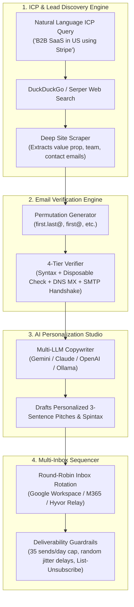

# OpenExplee

> **The Free & Open-Source, Self-Hosted Alternative to Explee**  
> AI-driven B2B lead discovery, deep website intelligence, real-time mailbox verification, AI personalization, and multi-inbox cold email dispatching — with zero monthly SaaS subscriptions.

[](https://opensource.org/licenses/MIT)
[](https://www.python.org/downloads/)
[](https://www.docker.com/)
[](https://fastapi.tiangolo.com)
[](#)

---

## Why OpenExplee?

Commercial outbound platforms like Explee, Apollo, and Instantly charge **$100 to $300+/month** for bundled lead databases and sending pools. Under the hood, these tools simply chain web scrapers, DNS/SMTP checks, LLMs, and email dispatchers.

**OpenExplee gives you the entire pipeline completely free and open-source.** You keep 100% data ownership, run it on your own machine or a $5 VPS, and only pay direct provider costs (e.g. $9/yr for secondary domains and pennies for API tokens).

### Explee SaaS vs. OpenExplee

| Feature | Explee SaaS | OpenExplee (Self-Hosted) |
| :--- | :--- | :--- |
| **Monthly Subscription** | $100 – $300+ / month | **$0 / month** (MIT Licensed) |
| **Lead Discovery & ICP Search** | Proprietary database & credit system | **Crawl4AI & Organic Web Crawlers** |
| **Email Verification** | Paid credit consumption | **Built-in 4-Tier DNS + SMTP Handshake** ($0) |
| **AI Personalization** | Locked to proprietary agents | **Gemini, Claude, OpenAI, Groq, or Local Ollama** |
| **Sending Infrastructure** | Shared multi-tenant sending pool | **Your Own Lookalike Domains & Inboxes** |
| **Account Providers** | Restricted | **Google Workspace, Microsoft 365, Hyvor Relay, Custom SMTP** |
| **Data Ownership** | Vendor cloud | **100% Private (Local SQLite / PostgreSQL)** |
| **Estimated Annual Cost** | **$1,200 – $3,600+ / yr** | **~$15 – $30 / month** (only your own mailboxes) |

---

## Architecture



---

## Key Features

* **Natural Language ICP Discovery:** Describe your target customer in plain English. OpenExplee finds matching websites, scrapes their core offerings, and identifies decision-makers.
* **4-Tier Non-Intrusive Email Verifier:**
  1. RFC 5322 Syntax validation.
  2. Disposable burner email domain blocklist.
  3. Live DNS MX record lookup and prioritization.
  4. Non-intrusive SMTP handshake (`EHLO` &rarr; `MAIL FROM` &rarr; `RCPT TO`) to verify mailbox existence without sending mail.
* **Multi-LLM Personalization:** Generate hyper-personalized cold outreach based on live website findings using:
  - **Google Gemini** (Recommended: fast, ultra-cheap)
  - **OpenAI** (`gpt-4o-mini`, `gpt-4o`)
  - **Anthropic** (`claude-3-5-sonnet`, `claude-3-5-haiku`)
  - **Groq** (`llama-3.3-70b`)
  - **Ollama** (100% offline and free)
* **Domain Firewall & DNS Deliverability Auditor:** Built-in SPF, DKIM, and DMARC record checker to ensure secondary domains have 100/100 health before sending.
* **Multi-Inbox Rotation & Spintax:** Connect multiple Google Workspace, Microsoft 365, or [Hyvor Relay](https://github.com/hyvor/relay) SMTP inboxes. OpenExplee rotates between them to stay well below spam thresholds.
* **Modern Single-Container UI:** Clean, responsive dark-mode dashboard with real-time KPI metrics, lead tables, live test tools, and campaign wizards.

---

## Quickstart

### Option A: Run with Docker Compose (Recommended)

1. Clone the repository:
   ```bash
   git clone https://github.com/vikasvardhanv/openexplee.git
   cd openexplee
   ```

2. Copy the example environment file and add your preferred LLM key:
   ```bash
   cp .env.example .env
   # Edit .env and set GEMINI_API_KEY=your_key or OPENAI_API_KEY=your_key
   ```

3. Launch OpenExplee:
   ```bash
   docker compose up -d
   ```

4. Open your browser at **`http://localhost:8000`**.

---

### Option B: Run Locally with Python

1. Clone and create a virtual environment:
   ```bash
   git clone https://github.com/vikasvardhanv/openexplee.git
   cd openexplee
   python3 -m venv venv
   source venv/bin/activate
   ```

2. Install dependencies:
   ```bash
   pip install -r requirements.txt
   ```

3. Start the application:
   ```bash
   python -m uvicorn app.main:app --host 0.0.0.0 --port 8000 --reload
   ```

4. Navigate to **`http://localhost:8000`**.

---

## Deliverability Best Practices (Domain Firewall)

Never use your primary company domain for outbound sales. Follow our detailed guides:

1. **[Secondary Domain Firewall Guide](docs/DOMAIN_FIREWALL_GUIDE.md):** How to buy $9 lookalike domains (`trycompany.com`), point 301 redirects, and configure SPF, DKIM, and DMARC.
2. **[Inbox Setup & Authentication Guide](docs/INBOX_SETUP_GUIDE.md):** Step-by-step setup for Google Workspace App Passwords, Microsoft 365 Authenticated SMTP, and Hyvor Relay.

---

## Contributing

Contributions are welcome! Feel free to submit issues or pull requests:
- Fork the repo
- Create your feature branch (`git checkout -b feature/cool-feature`)
- Commit your changes (`git commit -m 'Add cool feature'`)
- Push to the branch (`git push origin feature/cool-feature`)
- Open a Pull Request

---

## License

This project is licensed under the [MIT License](LICENSE).
